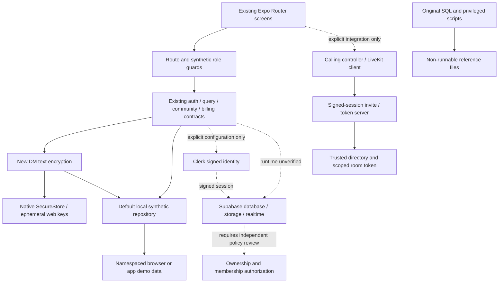
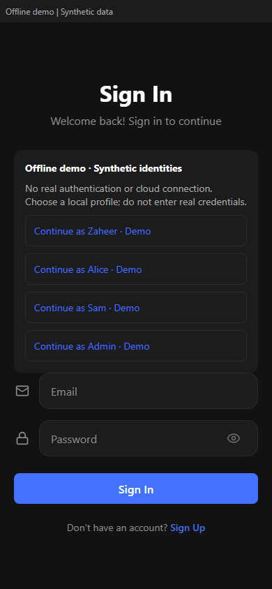
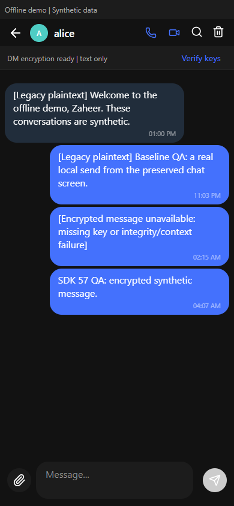
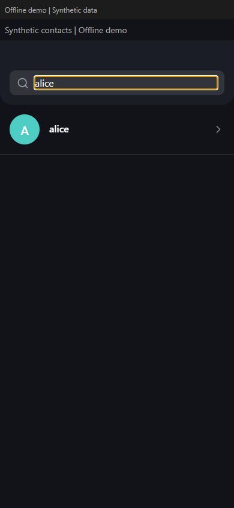
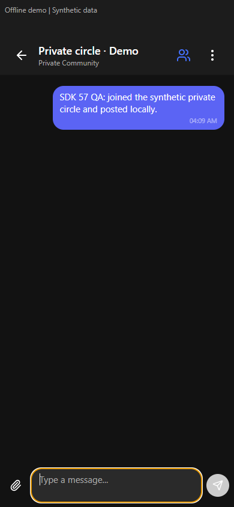

# Lockra

Zaheer's existing Expo / React Native / TypeScript messaging application, restored as a complete offline portfolio application. Clerk and Supabase integration architecture remains available behind deliberate configuration. The private original and its history remain private.

This is the substantial original application: 151 preserved source paths, including all 41 original app TypeScript paths. It retains the messaging and community services, account/session flows, contacts, settings, admin screens, subscription queries and database source. See [authorship](ATTRIBUTION.md) and the [feature/source preservation mapping](docs/FEATURE-PRESERVATION.md).

**Current mode: offline demo with synthetic identities and data.** It does not authenticate a real person, contact cloud services or demonstrate production security. DM text encryption now uses maintained noble libraries, explicit fingerprint verification, ciphertext storage and tests. Calling now has LiveKit SDK adapters, controls and an authenticated API with mock tests, and is disabled in demo. These are new implementation phases, not claims about the original source.

## Run locally

Use Node 22 (verified local runtime: 22.23.3, npm 10.9.9).

```powershell
npm ci
npm run build:web
npm run preview:web
```

Open `http://127.0.0.1:4177`, choose Sign In, then a clearly labelled synthetic profile. `npm start` is the localhost-only development command; it uses one Metro worker, disables environment-file discovery and telemetry, and forces demo mode. The production web export is the browser QA target. Never enter real credentials or messages.

`.npmrc` deliberately ignores install lifecycle scripts. Their review and dependency-resolution failures are recorded in [baseline evidence](docs/BASELINE.md). Do not use force, legacy-peer-deps or overrides to conceal installation failures. The original lock/manifest drift, incompatible Lucide React peer, obsolete Clerk package and missing lint tooling were investigated rather than hidden.

No environment file is needed. `.env.example` contains documented public placeholders only and is not automatically loaded. SDK initialization requires an explicit integration mode, enable flag and complete configuration; missing/example configuration fails before service traffic. Do not put privileged keys into Expo public variables, app configuration or client code.

## Preserved features and verification boundaries

| Area | Current evidence and limit |
|---|---|
| Direct messaging | Existing list/conversation UI, local send/read states and synthetic persistence; browser baseline send checked. New text sends require verified encryption keys; history and realtime decode in memory. Legacy plaintext is labelled; encrypted attachments are unavailable. Supabase realtime across real clients remains unverified. |
| Communities | Original discovery, invite, membership, messages, role, moderation and attachment service contracts retained. Offline service tests cover create/send/join/leave and authorization denial. No group-encryption claim. |
| Contacts and new chat | Existing screens use the synthetic directory; contacts search is an actual input. |
| Account and sessions | Original Clerk integration forms remain; demo chooses a local identity. No real authenticated integration claim. Cached profile JSON and JWT decoding cannot authorize access. |
| Profile/settings/security | Existing source retained. Native/device/MFA/secure-boot behavior is unverified; the original secure-boot provider is an unlocked stub. |
| Admin | All screens retained. Ordinary profiles are denied before admin screens mount. Arbitrary SQL and maintenance execution are disabled; no invented backup/optimization success. |
| Premium/billing | Original premium UI and subscription queries retained. No payment creation, live billing or fabricated subscription. |
| Attachments/notifications/ads/email | Source contracts retained; cloud delivery/uploads and retired ads are unavailable by default. Native workflows require separate device verification. |
| Logging | Existing event/error abstractions remain, with a disabled client sink. A future privileged provider adapter belongs on a reviewed server. |
| Calling | LiveKit web/native adapters, permission and cleanup state machine, authenticated invites and scoped server tokens implemented and mock-tested. No provider/two-client or native runtime verification. Disabled in demo. |

## Architecture



Support providers/types were relocated outside Expo Router discovery with their source mapped. The original community algorithms are injectable so tests execute existing logic against an explicit local integration mock. The drawer and tab UI retain their design while route handling stays with Expo Router.

## Checks and evidence

```powershell
npm test
npm run typecheck
npm run lint
npm run build:web
```

Baseline: 22 assertion tests passed, followed by 28 in the encryption phase and 41 in the calling phase. The reviewed restoration had 45 tests; the session-boundary repair added 22 signed-JWT/HTTP Origin regressions. The supported SDK57 follow-up adds URL-boundary and residual-policy regression coverage. Current actual results are in the [SDK57 review](docs/SDK57-RESIDUAL-REVIEW.md); the [restoration report](docs/RESTORATION-REPORT.md) retains earlier export/browser evidence. No remote GitHub Actions run has been verified.

The app uses Expo 57.0.30, React Native 0.86.3, SDK57-aligned React/React DOM 19.2.3, TypeScript 6.0.3, Clerk Expo 4.12.0 and Supabase JS 2.118.0. The unused optional RSC transport is omitted from this existing non-RSC SPA; no vulnerable RSC downgrade was applied. The original SDK 53 restoration is preserved in the verification history. See the [maintenance record](docs/SDK-MAINTENANCE.md) and [dependency audit status](docs/DEPENDENCIES.md). Version/peer acceptance is not native runtime proof. LiveKit requires a custom development build and cannot run in Expo Go. Native permissions, storage, iOS, Android and two-device behavior remain untested; Windows/web checks establish only their stated scope.

The raw audits retain their real finding counts and exit codes; totals alone do
not establish runtime risk. The user's current gate prohibits critical/high
runtime paths, permits documented residual risks with evidence and mitigation,
and forbids dependency forks/backports. [SECURITY.md](SECURITY.md) documents every
remaining advisory at its original severity. The moderate decoder is a real
runtime residual: browser startup/back/hash URLs are validated and bounded before
routing, and the local preview rejects malformed/oversized request URLs. Native
intent and real integration behavior remain unverified.

`npm run audit:dependencies` performs fresh full/production audits, exports all
three platform JavaScript source maps and inspects the optional calling-server
graph against the [explicit residual policy](docs/dependency-risk-policy.json).
It fails on unknown/changed advisory paths or versions and critical/high runtime
code. These exports do not compile native apps or prove device operation. CI
also retains blocking Expo install --check and pinned Doctor validation without
exclusions. See the [current review](docs/SDK57-RESIDUAL-REVIEW.md) for actual results
and the precise remaining publication gates.

Calling requires a signed browser **session token** with nonempty sid, authorized
azp and configured audience. Its HTTP API independently requires an allowed
Origin on every request. Origin-less same-origin/native transports remain
unsupported pending review; no permissive fallback was added. See the
[calling contract](docs/CALLING.md).

## Security, privacy and provenance

All historic SQL is retained as non-runnable `.txt` reference under `docs/legacy`, including unsafe SECURITY DEFINER functions and permissive policies. No SQL was executed, and RLS is not claimed verified. Real provisioning/admin operations require an authorized server boundary and isolated negative policy tests.
Legacy RPCs are quarantined before real-client execution. The new DM schema is a
guarded, non-runnable review draft; real integration still needs an independently
tested migration and authorization policies.

Demo startup isolates provider configuration, blocks nonlocal fetch/XHR/sockets and uses a local-only web content policy. No tunnel, OTA association, service credentials or cloud deployment is included. Screenshots must contain only synthetic data. Original PNGs passed independent pixel and metadata privacy review. That review grants no new rights; original notices remain and no blanket MIT license is asserted for legacy source or assets.

This publication copy is authorized separately from the private original. Independent source review found no concrete critical/high runtime issue; raw and UTF16-normalized privacy scans found no secrets. The original remains private. The exact fresh commit must pass private-repository CI before public visibility. See [publication evidence](docs/PUBLICATION-REVIEW.md).

Read [SECURITY.md](SECURITY.md), [CONTRIBUTING.md](CONTRIBUTING.md), and [ZAHEER-GUIDE.md](ZAHEER-GUIDE.md) for the trust boundary and interview walkthrough.

## Genuine local screenshots

Captured from the final SDK 57 web export using synthetic data, at 390×844.
Chat was also checked at [1440×900](docs/screenshots/chat-wide-final.png).
The demo holds both participants' keys in one browser; this is not two-device proof.
Reload loses web keys and displays an explicit unavailable message for that history.

| Authentication chooser | DM text after an encrypted local send |
|---|---|
|  |  |

| Contacts filtered by the actual search input | Private community joined and posted locally |
|---|---|
|  |  |

The [calling panel](docs/screenshots/calling-disabled-final.png) accurately reports
that calls are unavailable offline. It is not a screenshot of a working call.

The [DM encryption threat model](docs/E2EE.md) describes device-held keys,
explicit fingerprint comparison, rotation, ephemeral web keys, migration and recovery
limits. This DM-only application protocol requires independent security review;
it makes no group, call encryption, forward secrecy or production-security guarantee.

See [calling setup and platform limits](docs/CALLING.md). The optional local server
requires explicit configuration and a trusted development identity allowlist.
Its in-memory signaling is not a production database or a substitute for backend
authorization. No provider credentials, account, deployment or real calls were used.
